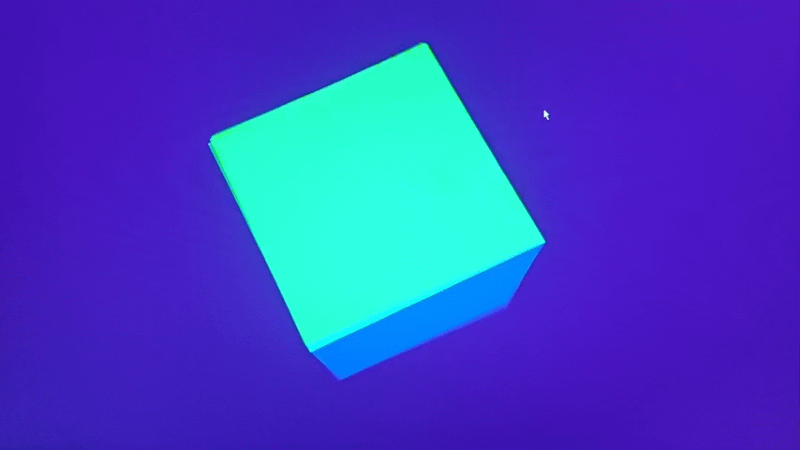
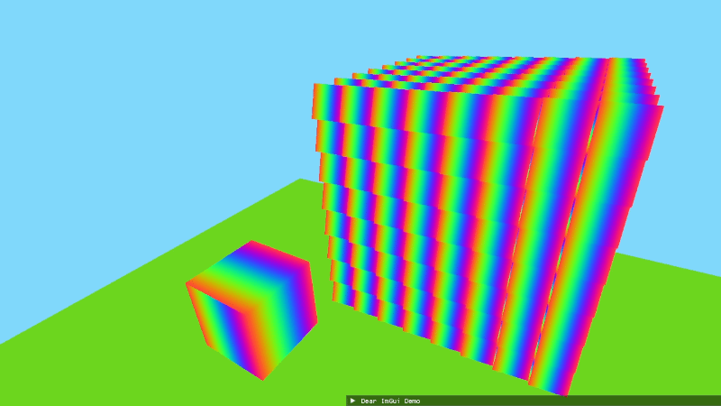
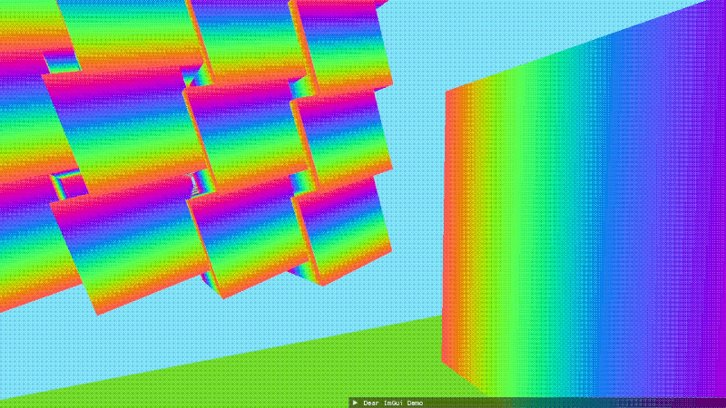

# __Flux__

                     

## 3D Rendering Engine  

 Flux is a 3D Rendering Engine entirely developed by me at the moment. Flux relies on modern C++, and a few external libraries which are GLM, GLFW and GLAD. Flux is intented to be a small engine aimed at computer graphics experiments.

## Who am I?

Hello, I'm Zaoshi. I've been interested in coding since I was a teen, I liked coding some projects from time to time. However it has only been recently that I've become more serious about programming. I discovered computer graphics back in 2025, I really enjoyed understanding how things work under the hood and now I'm determined to pursue math and programming as my career, so I decided to pursue computer graphics further as a hobby because it genuinely makes me feel accomplished. So my goal for this engine is simply to feel enjoyment from it as I'm developing it and to implement what I find interesting about engines and computer graphics.

## How can you download it?

If you're interested in downloading the engine to test it or modify, you are free to do so. However, I do not provide compiled executables yet and I only support OpenGL as a graphics API and haven't looked in supporting multiple operating systems. I use Cmake with vcpkg for dependencies and the gcc compiler.

## Development

I work regularly on Flux, and usually commit at least once per week. I have a list of features I want to implement you can check [the list here](TODO.md).
I also have a showcase file with screenshots of what I've already done if you care about seeing what I've accomplished yet, you can check next

## __Showcase__

## Rotating cube colored by normals

## Rotating rainbow cubes with free camera

## 4x4 Bayer dithering post-processing effect

